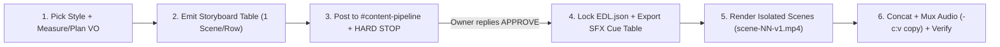

# motion-graphics — Procedural Motion Graphics (Local Only, Zero Credits)

Build design-led motion graphics and narrated vertical/horizontal reels locally in code via **HyperFrames** (`HTML/SVG/Canvas2D + GSAP → MP4`).

## Non-Negotiable Guardrails (Local Only)

1. **TEXT IS DRAWN AS VECTOR, NEVER GENERATED AS AN IMAGE**: Every word, number, badge, and callout on screen is rendered as live DOM/SVG/Canvas2D vector text. Spelling is 100% deterministic and always exact.
2. **NO IMAGE GENERATOR, NO VIDEO CREDITS, NO AFTER EFFECTS**:
   - Do **not** call `GEMINI_API_KEY`, `GOOGLE_API_KEY`, OpenRouter video generation, paid stock APIs, or external asset downloaders.
   - All visuals, cards, charts, UI chrome, textures, and transitions are procedurally drawn locally in HTML/CSS/SVG/Canvas2D.
3. **DO NOT DUPLICATE EXTERNAL SKILL COPIES — REFERENCE THEM**:
   - Base HyperFrames category modules (`categories/<id>/module.md`), subagent prompts (`agents/director.md`, `agents/builder.md`, `agents/finalize.md`), and block catalog (`catalog-map.md`, `references/motion-vocabulary.md`) live at `[REDACTED_PATH]` and `[REDACTED_PATH]` (symlinked into this skill directory without file duplication).
   - Narrated production rules & verification gates follow `[REDACTED_PATH]` and `[REDACTED_PATH]`.
4. **VOICEOVER IS MEASURED TO EXACT WORD SECONDS (LEVEL 3 CHOREOGRAPHY)**:
   - Synthesize voiceover locally via **Kokoro ONNX** (`env -u PYTHONPATH [REDACTED_PATH]`) or free Edge TTS — or accept a user-supplied local audio file — and measure exact word timestamps via local **`faster-whisper`** (`~/.hermes/cache/opt/whisper-venv`, `base.en`, `word_timestamps=True`) into `words.json` (`[{w, s, e}, ...]`), locking `EDL.json` (`action_cues` bound to exact spoken-word seconds) *before* writing scene drawing code ("Plan it once, check it, code it once, check it, then render it once"; full SOP: `[REDACTED_PATH]`). *(Honest capability note: we do **not** have ElevenLabs voices or music/SFX installed; use local Kokoro/Edge TTS + procedural Python `sfx.py`/`make_audio.py`.)* *Why:* "When the voice says, 'He struck,' the blade moves on struck, not near it, on it" — TTS line durations only bound whole sentences, leaving intra-scene drawing actions guessing the beat unless Whisper listens back first.
5. **STORYBOARD-FIRST APPROVAL GATE (HARD STOP BEFORE RENDER)**:
   - Phase 1 produces the **Storyboard Table** (one scene per row) and posts it for owner approval. **Never render in Phase 1.** Changing a row in the storyboard table costs $0 and 0 render seconds.

---

## 1. Named Style Menu (5 Signature Styles + Dynamic Index Query)

Users can pick from the **5 Named Signature Styles** below by name (matching and exceeding the AIpreneur 5-style workflow), or query the full local catalog of **45 Lemo styles** and **Herk Edit Kit cards/templates** dynamically from `[REDACTED_PATH]`.

### The 5 Named Signature Styles

| # | Style Name (`slug`) | Visual Identity (Palette, Type & Motion) | When to Use (One-Line Purpose) | Local Backing Spec / Cards |
|---|---|---|---|---|
| 1 | **`editorial-collage`** | Warm archive paper (`#EFE9DC`), warm ink (`#17130E`), cutout orange (`#F26A1B`), editorial red (`#E23B2E`), AIS blue (`#37BDF8`); `Fraunces` serif + `Archivo` + `Caveat` margin notes; torn-paper strips sweep in, halftone cutouts, choppy low-shutter stop-motion cadence. | **Vox-style editorial explainers**: history, research, investigative breakdowns, and document-led storytelling. | `[REDACTED_PATH]` (106 cards in `registry.json`) + `[REDACTED_PATH]` |
| 2 | **`kallaway-glass`** | Near-black cool canvas (`#080B12`) with deep cyan/indigo aurora glow (`#38BDF8`, `#818CF8`); frosted glass panels (`backdrop-filter`, 1px specular border highlights, heavy soft shadow); oversized gradient hero numbers; smooth inertial spring motion (`easeOutBack`). | **Premium dark tech & creator explainers**: SaaS, AI, business breakdowns, and high-retention hero metrics. | `[REDACTED_PATH]` (300 cards in `registry.json`) + `[REDACTED_PATH]` + `[REDACTED_PATH]` |
| 3 | **`bento-grid`** | Crisp modular bento tile grid on matte slate (`#0F1115`) or clean studio white (`#F8FAFC`) with lime highlighter accents (`#A3E635` / `#84CC16`); geometric sans + monospace step badges; tile-by-tile staggered reveals with inline vector mini-charts (uses step numbers when script has no figures — never invents stats). | **Numbers, lists & structured frameworks**: step-by-step systems, multi-point comparisons, and KPIs. | `[REDACTED_PATH]` + `[REDACTED_PATH]` + `[REDACTED_PATH]` |
| 4 | **`neo-brutal`** | High-voltage yellow ground (`#FACC15` / `#FFE600`), 3–4px pure black ink borders (`#0A0A0A`), hard offset shadows (`6px 6px 0 #000000`), heavy grotesk display type; keywords slam onto cards as colored vector stickers (`#FF3366`, `#00F5D4`, `#FFFFFF`) with snappy overshoot and final-line freeze hold. | **Contrarian hooks & punchy takes**: myth-busting shorts, bold rules, and high-contrast pattern interrupts. | `[REDACTED_PATH]` + `[REDACTED_PATH]` |
| 5 | **`youtube-clean`** | Clean white/light-gray studio grid (`#F9FAFB` / `#FFFFFF`), slate ink (`#111827`), signature crimson (`#EF4444` / `#FF0000`) + neutral gray card stacks (`#E5E7EB`); vector player chrome, watch-time progress scrubbers, live countdown timers, and card stack sinks. | **Creator economy & platform/UI stories**: algorithm mechanics, retention breakdowns, and product walkthroughs. | `[REDACTED_PATH]` + `[REDACTED_PATH]` |

### Command 1: `list styles` ("What styles do I have and what is each for?")

Never hard-code the full catalog in prompts. Run this local command to print the 5 named signature styles followed by all **45 Lemo styles** and **Herk Edit Kit styles/templates/cards** read directly from `[REDACTED_PATH]` and `[REDACTED_PATH]`:

```bash
python3 -c '
import json

NAMED_5 = [
    ("editorial-collage", "Vox-style torn paper collage on warm cream with orange/blue highlights -> history, research & editorial explainers"),
    ("kallaway-glass",    "Glowing frosted glass panels over dark aurora canvas with gradient hero stats -> tech, AI & business explainers"),
    ("bento-grid",        "Modular bento tiles with lime highlighter, step badges & inline vector charts -> numbered lists, frameworks & metrics"),
    ("neo-brutal",        "High-voltage yellow cards with thick black borders & slammed keyword stickers -> contrarian hooks & bold social shorts"),
    ("youtube-clean",     "Clean white studio grid with crimson/gray feed cards, player scrubbers & timers -> creator/algorithm & UI stories"),
]
print("=== 5 NAMED SIGNATURE STYLES ===")
for slug, purpose in NAMED_5:
    print(f"  - {slug}: {purpose}")

with open("[REDACTED_PATH]", encoding="utf-8") as f:
    idx = json.load(f)

lemo = {}
herk = []
for e in idx:
    cat = e.get("category", "")
    if cat in ("lemo-opuscar/styles", "lemo-styles") and e.get("kind") == "style":
        lemo.setdefault(e["name"], e)
    elif cat == "herk-edit-kit":
        herk.append(e)

print(f"\n=== LEMO CODE-DRAWN STYLES ({len(lemo)} from [REDACTED_PATH]) ===")
for name in sorted(lemo):
    purpose = lemo[name]["purpose"]
    print(f"  - {name}: {purpose}")

print(f"\n=== HERK EDIT KIT STYLES & TEMPLATES ({len(herk)} from [REDACTED_PATH]) ===")
for e in herk:
    ename, ekind, epurpose = e["name"], e["kind"], e["purpose"]
    print(f"  - {ename} ({ekind}): {epurpose}")

with open("[REDACTED_PATH]", encoding="utf-8") as f:
    reg = json.load(f)
card_count, style_count = reg["cardCount"], reg["styleCount"]
print(f"\n=== HERK STYLE-LIBRARY CARDS ({card_count} cards across {style_count} styles) ===")
for s in reg["styles"]:
    sid, sname, scount, sinsp = s["id"], s["name"], s["cardCount"], s["inspiration"][:120]
    print(f"  - {sid} ({sname}, {scount} cards): {sinsp}...")
'
```

---

## 2. Storyboard-First Procedure & Approval Gate

Every motion-graphics build is strictly divided into **Phase 1 (Storyboard & Approval Gate — $0, no rendering)** and **Phase 2 (Build, Render & Verification — only after explicit owner approval)**.



### Phase 1: Storyboard Table & Approval Gate (NO RENDERING)

1. **Select Style & Aspect**:
   - Pick a named style from the 5-style menu (or a slug from `[REDACTED_PATH]`) and target aspect (`9:16` vertical `1080×1920` for reels/Shorts, or `16:9` `1920×1080` for explainers).
2. **Voiceover Measurement / Timing Plan**:
   - If an audio file is provided or synthesized locally (Kokoro ONNX / Edge TTS), run `faster-whisper` (`~/.hermes/cache/opt/whisper-venv`, `base.en`, `word_timestamps=True`) to get exact word timestamps (`words.json`).
   - If planning pre-VO in Phase 1, budget spoken lines at `≤ 3.0–3.5 words/sec` with `0.3–0.6s` breath pauses between scenes and a `0.5s` silence before the final payoff line; lock exact Whisper word timestamps at the start of Phase 2 before drawing.
3. **Write the Storyboard Table (`[REDACTED_PATH]>-v1.md`)**:
   - Must contain **one scene per row** covering the full duration (e.g., 7–8 scenes for a 30.0s vertical reel, each scene `3.0–5.0s` so no beat exceeds the retention ceiling).
   - **Mandatory Storyboard Table Columns**:

| Scene # | Start–End (s) | Duration (s) | Style / Card | VO Line | On-Screen Text (Vector) | Visual & Motion Action (Word-Synced) | SFX Cue (Timestamp + Sound) |
|---|---|---|---|---|---|---|---|
| `S01` | `0.00–3.50` | `3.50s` | `youtube-clean` (`hook_card`) | *"..."* | `EXACT VECTOR COPY` | Continuous vector state transformation locked to keyword timestamp | `0.10s swoosh`, `1.85s click` |

4. **Include Style Adaptation & Constraint Notes Below the Table**:
   - Document any custom vector primitives built for the script (e.g., custom closed-eye icon, full-screen card stack sink, live player scrub timer) while keeping the chosen style's exact palette tokens, typography, and motion easing.
   - Explicitly state: `Local only • Vector text only • 0 image-gen calls • 0 video credits • Nothing rendered yet`.
5. **Commit & Post for Owner Approval (HARD STOP)**:
   - Commit the storyboard file in `[REDACTED_PATH]`.
   - Post the storyboard as **one message** to Discord channel `[REDACTED_PHONE]` (`#content-pipeline`) using `DISCORD_BOT_TOKEN` from `[REDACTED_PATH]` (never print the token), ending with:
     `Storyboard for approval: reply APPROVE or request changes`
   - **Read-Back Verification**: Fetch the posted Discord message ID back from the API to confirm delivery.
   - **STOP IMMEDIATELY.** Do not run `hyperframes render` or `ffmpeg` in Phase 1. Phase 2 starts only after the owner replies `APPROVE` in `#content-pipeline` and instructs Jarvis to render.

---

## 3. SFX Cue Table Format (`sfx-cues.md` & `sfx-cues.csv`)

Every composition must emit a standalone, editor-ready **SFX Cue Table** (`sfx-cues.md` and `sfx-cues.csv`) derived deterministically from the storyboard / `EDL.json` (`audio.sfx[]` and `action_cues[]`, following the `[REDACTED_PATH]` precedent).

### Standard SFX Cue Table Columns

| Cue # | Timestamp (s) | Timecode (`MM:SS.ms`) | Scene # | Sound / SFX Kind | Mix Level (dB) | Lands On (Exact Visual / Spoken Word Trigger) | Local Synth / Asset Source |
|---|---|---|---|---|---|---|---|
| `SFX-01` | `0.10` | `00:00.100` | `S01` | `swoosh` | `-12 dB` | Red hook card slides up into frame | `sfx.py:swoosh` |
| `SFX-02` | `1.85` | `00:01.850` | `S01` | `click` | `-10 dB` | Keyword badge `"NEVER WATCHED"` locks on spoken word *"watched"* | `sfx.py:click` |

### CSV Export Schema (`sfx-cues.csv`)

```csv
cue_id,timestamp_s,timecode,scene_id,sound,level_db,lands_on,source
SFX-01,0.10,00:00.100,S01,swoosh,-12.0,"Red hook card slides up into frame","sfx.py:swoosh"
SFX-02,1.85,00:01.850,S01,click,-10.0,"Keyword badge NEVER WATCHED locks on word 'watched'","sfx.py:click"
```

### Reproducible Export Command (`EDL.json` → `sfx-cues.md` + `sfx-cues.csv`)

Run this command on any project directory containing `EDL.json`:

```bash
python3 -c '
import csv, json, sys, os

edl_path = sys.argv[1] if len(sys.argv) > 1 else "EDL.json"
out_dir = os.path.dirname(os.path.abspath(edl_path))
with open(edl_path, encoding="utf-8") as f:
    edl = json.load(f)

cues = edl.get("audio", {}).get("sfx", [])
rows = []
for i, c in enumerate(cues, 1):
    at = float(c["at"])
    mm = int(at // 60)
    ss = at % 60
    tc = f"{mm:02d}:{ss:06.3f}"
    kind = c["kind"]
    rows.append({
        "cue_id": f"SFX-{i:02d}",
        "timestamp_s": f"{at:.2f}",
        "timecode": tc,
        "scene_id": c.get("scene", f"S{i:02d}"),
        "sound": kind,
        "level_db": c.get("level_db", "-12.0"),
        "lands_on": c["reason"],
        "source": c.get("source", f"sfx.py:{kind}"),
    })

csv_path = os.path.join(out_dir, "sfx-cues.csv")
with open(csv_path, "w", newline="", encoding="utf-8") as f:
    w = csv.DictWriter(f, fieldnames=["cue_id","timestamp_s","timecode","scene_id","sound","level_db","lands_on","source"])
    w.writeheader()
    w.writerows(rows)

md_path = os.path.join(out_dir, "sfx-cues.md")
with open(md_path, "w", encoding="utf-8") as f:
    f.write("# SFX Cue Table\n\n")
    f.write("| Cue # | Timestamp (s) | Timecode | Scene # | Sound | Level (dB) | Lands On | Source |\n")
    f.write("|---|---|---|---|---|---|---|---|\n")
    for r in rows:
        cid, ts, tc, sid = r["cue_id"], r["timestamp_s"], r["timecode"], r["scene_id"]
        snd, lvl, lnd, src = r["sound"], r["level_db"], r["lands_on"], r["source"]
        f.write(f"| `{cid}` | `{ts}s` | `{tc}` | `{sid}` | `{snd}` | `{lvl} dB` | {lnd} | `{src}` |\n")
print(f"Exported {len(rows)} cues -> {csv_path} and {md_path}")
' "${PROJECT_DIR:-.}/EDL.json"
```

### Mixing Guidelines (CapCut / FFmpeg / `make_audio.py`)
- **Voiceover**: Anchor track normalized to **`-14.0 LUFS`** (`true_peak <= -1.0 dBTP`).
- **SFX Cues**: Placed at exact `timestamp_s` (`0.0 ms` drift) around **`-10 dB` to `-14 dB`** so speech remains completely clear.
- **Music Bed**: Ducked under voice at **`-18 dB` to `-22 LUFS`** with fade-in/out; **cut the music bed `0.5s` before the final payoff line** so the closing hook lands in crisp silence.

---

## 4. The One-Scene Re-Render Rule (Scene Isolation & Byte-Identical Guarantee)

**Rule**: *"Fix one scene with one sentence → re-render ONLY that scene, keep `v1`, save `v2`, and prove all untouched scenes are byte-identical."*

This gives deterministic **surgical control** (changing Scene 5 cannot accidentally mutate typography, layout, or timing in Scenes 1–4 or 6–7) and avoids full-reel re-render churn on longer videos.

### Directory & Versioning Contract

```text
<project-dir>/
├── EDL.json                        # Master scene timing + word-sync action cues + SFX cues
├── sfx-cues.md / sfx-cues.csv      # Exported editor cue sheet
├── scenes/
│   ├── scene-01/index.html         # Self-contained sub-composition for Scene 01
│   ├── scene-02/index.html         # ...
│   └── scene-05/
│       ├── index-v1.html           # Preserved v1 scene source
│       └── index.html              # Updated v2 scene source
└── renders/
    ├── scenes/
    │   ├── scene-01-v1.mp4         # Initial scene renders (NEVER overwritten)
    │   ├── scene-02-v1.mp4
    │   ├── ...
    │   ├── scene-05-v1.mp4         # Kept intact when Scene 05 is revised!
    │   ├── scene-05-v2.mp4         # Newly rendered replacement for Scene 05 ONLY
    │   ├── sha256-v1.txt           # Checksums recorded after v1 build
    │   ├── sha256-v2.txt           # Checksums recorded after single-scene v2 re-render
    │   ├── concat-v1.txt           # FFmpeg concat list for v1 reel
    │   └── concat-v2.txt           # FFmpeg concat list swapping ONLY scene-05-v2.mp4
    ├── reel-v1.mp4                 # Assembled v1 master
    └── reel-v2.mp4                 # Assembled v2 master (stream-copied video, 0 re-encode of untouched scenes)
```

### Step-by-Step Single-Scene Re-Render Procedure

When the owner says *"Change Scene `K`: <one-sentence instruction>"*:

1. **Freeze & Verify `v1` Checksums Before Touching Anything**:
   ```bash
   (cd "$PROJECT_DIR" && sha256sum renders/scenes/scene-*-v1.mp4 > renders/scenes/sha256-v1.txt)
   ```
2. **Preserve Scene `K` Source and Edit Only Scene `K`**:
   - Copy `scenes/scene-0K/index.html` to `scenes/scene-0K/index-v1.html` (or keep `v1` state in `EDL.json`).
   - Modify **only** Scene `K`'s composition (`scenes/scene-0K/index.html`) or time-slice (`--start <t0> --end <t1>`), keeping Scene `K`'s exact `data-duration` identical to `v1` so downstream scene and SFX timestamps never shift.
3. **Render ONLY Scene `K` to `renders/scenes/scene-0K-v2.mp4` (Keep `v1`!)**:
   ```bash
   # Never overwrite renders/scenes/scene-0K-v1.mp4
   (cd "$PROJECT_DIR" && npx hyperframes render scenes/scene-0K \
     --fps 30 -q high -o renders/scenes/scene-0K-v2.mp4)
   ```
4. **Splice `reel-v2.mp4` via Lossless Stream Copy (`-c:v copy`)**:
   - Write `renders/scenes/concat-v2.txt` referencing `scene-01-v1.mp4`, ..., `scene-0K-v2.mp4`, ..., `scene-NN-v1.mp4`.
   - Concatenate video streams with `-c:v copy` (identical H.264 codec/profile/timebase across scenes) and mux `assets/master_audio.wav`:
   ```bash
   (cd "$PROJECT_DIR" && ffmpeg -y -f concat -safe 0 -i renders/scenes/concat-v2.txt \
     -i assets/master_audio.wav -c:v copy -c:a aac -b:a 192k -shortest renders/reel-v2.mp4)
   ```
5. **Mandatory Byte-Identical Verification Proof**:
   ```bash
   (cd "$PROJECT_DIR" && sha256sum -c renders/scenes/sha256-v1.txt && \
     sha256sum renders/scenes/scene-*-v*.mp4 | tee renders/scenes/sha256-v2.txt)
   ```
   - **Acceptance criteria**:
     - `sha256sum -c renders/scenes/sha256-v1.txt` prints `OK` for **every** `scene-*-v1.mp4` (including `scene-0K-v1.mp4`, proving `v1` was kept and all other scenes' bytes are 100% untouched).
     - `renders/scenes/scene-0K-v2.mp4` exists, is non-empty, has a distinct SHA-256 from `scene-0K-v1.mp4`, and matches Scene `K`'s exact duration.

---

## 5. Base HyperFrames Block & Category Dispatch (Referenced, Not Duplicated)

For single-shot overlays or category-specific building blocks, this skill references the existing HyperFrames modules in `[REDACTED_PATH]` (and `[REDACTED_PATH]`) via local symlinks:

- **Director & Builder Subagent Prompts**: `agents/director.md`, `agents/builder.md`, `agents/finalize.md`
- **Block Catalog & Motion Vocabulary**: `catalog-map.md`, `references/motion-vocabulary.md`, `references/shot-plan-ir.md`, `references/builder-contract.md`
- **Form Categories (local, zero external search/generation)**:
  - `kinetic-type` (`categories/kinetic-type/module.md`) — punchy line / quote / title, motion-first vector text
  - `stat` (`categories/stat/module.md`) — single hero number / count-up + ring / bar
  - `charts` (`categories/charts/module.md`) — bar / line / pie / race / % from data
  - `logo-reveal` (`categories/logo-reveal/module.md`) — vector SVG path draw / brand lockup
  - `lower-thirds` (`categories/lower-thirds/module.md`) — name / title bars, callouts, social overlays
  - `maps` (`categories/maps/module.md`) — vector geographic motion (`us-map` / `world-map`)
- **Cartoon-Simple Anatomy, Parameterized Rigs & Continuous Transformation Rule**:
  - Every scene must include a continuous state transformation (bar filling, card stack sinking, rock morphing into a blade, counter driving geometry, paper strip unfolding) so nothing hangs static. *Why:* static code drawings replicate the worst flaw of still AI pictures ("Zeus throws a lightning bolt, and the bolt just hangs there, in the air, forever").
  - Define each recurring code-drawn character or mascot once as a parameterized JS function (`drawCharacter(ctx, pose)`) using simple cartoon silhouettes (**big round head, simple torso, circle/mitten hands**, or expressive object/UI mascots — never realistic multi-joint human limbs), frame around full-body leg/hip chair bends (use waist-up framing or foreground occlusion), and keep primary characters `≥ 18–25%` of canvas height even in wide shots. *Why:* realistic human limbs in procedural 2D JS render "stiff, like a wooden doll", seated full-body rigs "sit on a throne by standing on the seat", unguarded wide shots shrink characters until "the titans in the wide shots came out tiny", and a single shared function prevents per-shot style drift across 1,000–3,700 frames.
- **30–45s Batch Stopwatch Rule (`~15–25 fps` Floor)**:
  - Time every 20–30s render batch (`600–900` frames) against a **30–45s wall-clock window** (`~15–25 fps`; external benchmark: `3,708` frames / `123.6s @ 30fps` in `172s` = `21.6 fps` at `$0` picture spend vs `$0.72` for 231 still AI images; internal test on our `1,152`-frame / `48s @ 24fps` blueprint film: `426.5s` capture/encode = `2.70 fps` / `177.7s` per 20s batch + `56.0s` redundant mux re-encode). If a batch exceeds **45s** (`< 10 fps`), profile the draw loop: cache static procedural textures (paper grain, washes, grids) to one offscreen `<canvas>` once at setup, draw active strokes directly on `mainCtx` instead of blitting multiple full-screen scratch canvases per frame, cull inactive scenes by time window (`if (t < s.t0 || t > s.t1) return;`), and mux audio with `-c:v copy`. *Why:* timing each batch with a stopwatch catches per-frame draw-loop and mux bottlenecks immediately before a long render times out.
